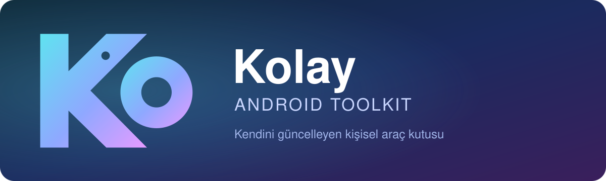

<p align="center"></p>

<p align="center">
  <a href="https://github.com/makolay322/Kolay-Android-Toolkit/releases/latest"></a>
  
  
  
</p>

<p align="center">
  <a href="#-araçlar">Araçlar</a> ·
  <a href="#-kurulum">Kurulum</a> ·
  <a href="#-güvenlik">Güvenlik</a> ·
  <a href="#-geliştirme-ve-işletme">Geliştirme</a> ·
  <a href="CHANGELOG.md">Sürüm notları</a>
</p>

> **Kolay**, telefonda çalışan kişisel bir araç kutusudur: OCR, helal sorgu, namaz vakitleri, kıble, QR ve dahası — tek bir Android uygulaması (Android 10+), tek APK.
> Yeni sürümleri GitHub'dan kendi indirir, **imzasını doğrular** ve kendini günceller.

<p align="center"><a href="https://github.com/makolay322/Kolay-Android-Toolkit/releases/latest"><b>⬇ Kolay.apk'yı indir</b></a></p>

## ✨ Araçlar

| Araç | Ne yapar |
|---|---|
| **Belgeler** | Tek belge akışı: sayfalar **kameradan** (otomatik sayfa algılama, istenirse sabit tutunca kendiliğinden çekim), **galeriden** ya da **Wi-Fi tarayıcıdan** (eSCL / AirScan; yalnızca yerel ağ, önce HTTPS, sertifika ilk bağlantıda sabitlenir) gelir, karıştırılabilir. Köşelerden kırpma, döndürme, filtre (Otomatik, Gri, Siyah-Beyaz, Gölge giderme). Sonra üç çıktı: **Kaydet** (PDF — isteğe bağlı aranabilir — ya da JPEG), **Metne çevir** (cihazda OCR; Almanca/Türkçe/İngilizce dil verisi ilk kullanımda indirilir, isteğe bağlı cilalama), **Tıbbi rapor** (Almanca belge: kişisel veriler cihazda maskelenir, sayfalar sıraya dizilip temizlenir; internet yoksa yerel metin, “Cilala” ile sonradan). Başka uygulamadan paylaşılan fotoğraflar paylaşım menüsündeki “Metne çevir” ile doğrudan okunur. |
| **PDF düzenle** | Belgeler ekranından, Dosyalar'daki bir PDF'in menüsünden ya da görüntüleyicideki kalem düğmesiyle açılır: sayfalar küçük resim ızgarasında; basılı tutup sürükleyerek sırala, 90° döndür, sil, başka PDF ekle (birleştir), galeriden görüntü sayfası ekle. Metin ve çizimler korunur (sayfalar yeniden çizilmez). Eklenen görüntü komşu sayfanın kâğıt boyutunu alır (yoksa A4; yatay görüntüde yatay), 300 dpi'yi aşmayacak biçimde küçültülüp (büyütülmez) %90 kaliteli JPEG olarak gömülür (PNG kayıpsız). Kayıt yeni dosya olarak (`ad_duzenlenmis.pdf`, aynı klasöre ya da `Documents/Kolay`) ya da onayla asıl dosyanın üzerine. Parolalı PDF parola sorularak açılır (kaydedilen dosya parolasız olur). |
| **Belge Görüntüleyici** | Salt okunur, hızlı görüntüleyici; “Birlikte aç” ile açılır: PDF (yakınlaştırma, sayfaya git), Word (.docx: biçim, başlık, liste, tablo, görsel), Excel (.xlsx: sekmeler, hücre ızgarası), PowerPoint (.pptx: slaytlar), metin ve CSV. Eski .doc/.xls/.ppt: bir kerelik indirilen eklentiyle (yalnızca metin; SHA-256 sabit). Belge internete çıkmaz. |
| **Helal Sorgu** | Barkoddan (Open Food Facts) ya da etiket fotoğrafından içindekileri alır, Hanefi ölçütleriyle *helal / haram / şüpheli* değerlendirmesi yapar. |
| **Cuma Mesajı** | Diyanet'in *Hadislerle İslâm* eserinden seçilmiş, öğüt içeren 274 hadisten biriyle rastgele, kare Cuma görseli çizer; kaydet / paylaş. |
| **Dosyalar** | Yerel dosya yöneticisi (ana sayfada kendi kartı): depolama alanları ve doluluk, kategoriler (Görseller, Videolar, Sesler, Belgeler, İndirilenler, APK'lar), son dosyalar, yer imleri; klasör gezme (yol çubuğu, liste/ızgara, sıralama, gizli dosyalar, arama), çoklu seçim, kopyala/taşı/yeniden adlandır/sil, yeni klasör, paylaş, birlikte aç, özellikler, ZIP sıkıştır/çıkart; **Ağ**: Samba (SMB 2/3) sunucuları (kayıtlı sunucular, ağda arama, paylaşımları gezme, telefon ↔ sunucu kopyala/taşı; yalnızca yerel ağ). Uzun işlemler ekran kapalıyken bildirimle sürer. Android 11+'da “Tüm dosyalara erişim” izni ister; dosya içerikleri internete gitmez (yalnızca kullanıcının seçtiği yerel ağdaki Samba sunucusuna). |
| **Sohbet** | Ufak tefek işler için sohbet kutusu (cilalama servisiyle): soru sor, metin düzelttir, çevirt, özetlet. Konuşma kaydedilmez; ekrandan çıkınca silinir. |
| **Namaz Vakitleri** | Konuma göre vakitler (Diyanet açıları), geri sayım, vakit başına hatırlatıcı ve ana ekran widget'ı. |
| **Kıble** | Kayıtlı namaz konumu ve telefonun pusulasıyla kıble yönü; manyetik sapma düzeltilir, kıbleye dönünce titreşir. |
| **Uygulama Güncelle** | Google Play dışından yüklenen uygulamalar için yeni sürüm arar: APKMirror + APKPure (hangisi daha yeniyse) ya da LiteAPKs, uygulama başına seçilir. İndirir, kurar, dosyayı siler. |
| **YouTube Özeti** | YouTube bağlantısından Türkçe özet; paylaşım menüsünde “YouTube Özet” olarak da çıkar. |
| **Fotoğraf Sıkıştır** | Seçilen fotoğrafın %90 kaliteli JPEG kopyasını `Pictures/Kolay`'a kaydeder. |
| **QR Kod** | Hızlı QR okuma (bildirim panelindeki hızlı ayar kutucuğundan da açılır) ve QR oluşturma: metin/bağlantı, Wi-Fi (şifreyle bağlanma) veya kişi kartı; kaydet / paylaş. |

Ana sayfanın üst köşesinde sade, tek renkli “Ko” logosu durur (animasyonsuz).
Yeni araç eklemek: [docs/ADDING_A_TOOL.md](docs/ADDING_A_TOOL.md).

## 📲 Kurulum

1. [Releases](https://github.com/makolay322/Kolay-Android-Toolkit/releases/latest) sayfasından **`Kolay.apk`** dosyasını (≈ 4,2 MB; 64 bit ARM, `arm64-v8a`) indirip yükle.
2. Uygulamayı aç → sağ üstte **Ayarlar** → *Gemini API anahtarı* alanına anahtarı yapıştır → **Kaydet**. Anahtar yalnızca
   cilalama, özet ve helal değerlendirmesi için gerekir; diğer araçlar anahtarsız çalışır.
3. Sonraki sürümler kendiliğinden iner ve doğrulanır; ana sayfada “Yeni sürüm hazır” bandına dokununca kurulur (Android 12+'da
   genellikle onaysız; uygulama kapanır, yeniden açınca yeni sürüm çalışır). Uygulama kapalıyken arka planda kendiliğinden de kurulur.

> [!NOTE]
> **1.026 veya daha eski** kurulumlar depo adı değiştiği için kendiliğinden güncellenemez; yeni APK'yı bir kez elle kurmak yeter, ayarlar ve anahtar korunur (ayrıntı: [CHANGELOG](CHANGELOG.md)).
> 1.013 veya daha eskiyse önce Ayarlar → **“Kabuğu indir ve yükle”** kullanılır.

> [!TIP]
> API anahtarı yalnızca telefonda, Android Keystore ile şifreli tutulur. Bu depoda **hiçbir sır yoktur**.

## ⚙️ Nasıl çalışır

```
 main'e push ──► GitHub Actions (release.yml) ──► Release vX: Kolay.apk + manifest.json
                 derle · keystore ile imzala ·            │  (SHA-256 + ECDSA imzası)
                 ECDSA güncelleme imzası                  ▼
 Telefon: Kolay ── 6–12 saatte bir manifest'i okur ── indirir · doğrular ── kendini günceller
```

- **`app.kolay.app`**: arayüz ve tüm araçlar.
- **`app.kolay.shell`**: platform katmanı — açılış, güncelleyici, şifreli anahtar deposu, namaz motoru/widget/alarmlar, QR kutucuğu.
- Güncelleme yalnızca imza (uygulamaya gömülü açık anahtar) ve APK sertifikası tutarsa kurulur.

`main`'e yapılan her push GitHub Actions'ta derlenir, imzalanır ve yeni sürüm olarak yayınlanır (`1.014`, `1.015`, …).
Ayrıntı: [docs/ARCHITECTURE.md](docs/ARCHITECTURE.md).

## 🔒 Güvenlik

- Güncelleme dosyaları GitHub'da durur ama **yalnızca sahibinin anahtarıyla imzalıdır**; uygulama imzayı ve APK sertifikasını doğrulamadan güncellemeyi kurmaz.
- OCR'da kişisel veriler buluta gitmeden önce cihazda maskelenir; OCR metni diske yazılmaz.
- “Uygulama Güncelle” bir dosyayı yalnızca paket adı, sürümü ve imzası yüklü uygulamayla uyuşuyorsa kurar.
- Yedekleme kapalı, yalnızca HTTPS.

Tam model: [SECURITY.md](SECURITY.md).

## 🛠 Geliştirme ve işletme

| Konu | Doküman |
|---|---|
| Mimari, açılış akışı, araçların iç işleyişi | [docs/ARCHITECTURE.md](docs/ARCHITECTURE.md) |
| Güncelleme protokolü ve manifest biçimi | [docs/UPDATE_PROTOCOL.md](docs/UPDATE_PROTOCOL.md) |
| Derleme, kurulum, test | [docs/DEVELOPMENT.md](docs/DEVELOPMENT.md) |
| Sürüm çıkarma, anahtarlar, geri alma, olay müdahalesi | [docs/OPERATIONS.md](docs/OPERATIONS.md) |
| Yeni araç ekleme | [docs/ADDING_A_TOOL.md](docs/ADDING_A_TOOL.md) |
| Arayüz sistemi (renkler, ölçüler, hareket) | [docs/UI.md](docs/UI.md) |
| Başka oturumlar / yapay zekâ için çalışma kuralları | [CLAUDE.md](CLAUDE.md) |
| Sürüm notları | [CHANGELOG.md](CHANGELOG.md) |

## ⌨️ Hızlı komutlar

```bash
./gradlew :app:assembleRelease     # APK; JDK 17 + Android SDK gerekir
tools/release.sh [sürümAdı]        # elle sürüm (normalde main'e push yeterli)
```

Üçüncü taraf bileşenler: [NOTICE.md](NOTICE.md).

---
<p align="center"><br><sub>Kolay · <a href="NOTICE.md">üçüncü taraf bileşenler</a> · <a href="SECURITY.md">güvenlik</a></sub></p>
